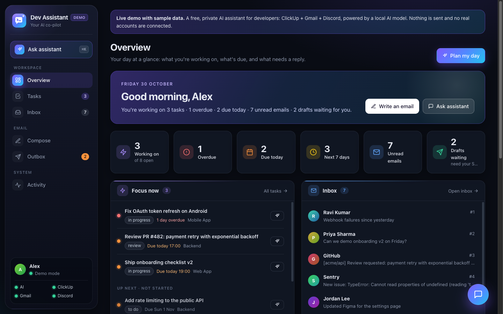
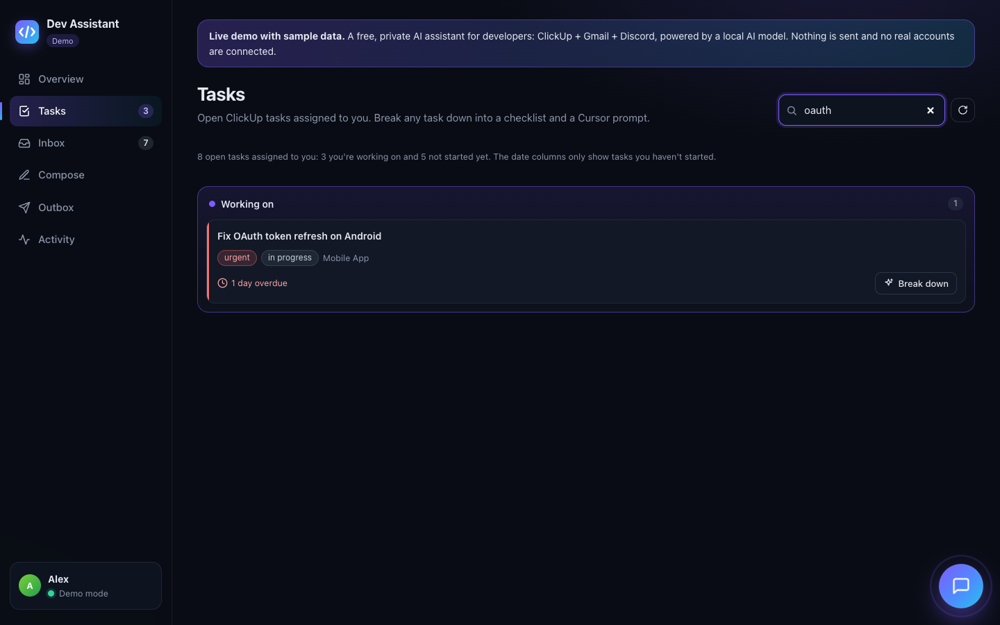

# Dev Assistant — free, local AI developer assistant

A private assistant that runs on your Mac, with a **web dashboard** and a **Discord bot**:



- 📊 **Dashboard** at `http://127.0.0.1:4747`: an overview of your day, tasks board, inbox with AI triage, compose, outbox, an activity feed and a floating chat button. Only reachable from your Mac and locked with a secret key.
- 🔁 **Runs by itself.** Installed as a macOS background service, it starts at login and restarts if it crashes. No more `npm start` every day.
- 🌐 **Public demo** for your portfolio or LinkedIn: the same dashboard with sample data, deployable free on Vercel. It never touches your real accounts.

- 🔔 DMs you when a **ClickUp task is assigned** to you, when tasks are **due within 24h** or **overdue**, and when **new emails** arrive (with a one-line AI triage).
- ☀️ Sends a **morning plan** (top priorities, emails to answer, risks).
- 🧩 `/task` turns a ClickUp ticket into acceptance criteria, a checklist, tests and a **ready-to-paste Cursor/Claude prompt**.
- 📤 `/compose` writes a **new email** to any address you give it, and `/draft` writes a **reply**. You get a preview with a **Send** button, and it sends only when you tap it.
- 💬 DM it in plain English ("what's overdue?", "email ravi@acme.com that the demo is ready for Thursday").

- 🧰 **MCP server.** Use the same assistant from **Cursor Agent** and **Claude Code**: read, comment on, create and update ClickUp tasks; search Gmail and send email; find Discord teammates and DM them. Sending email or DMs always needs a code you receive on Discord. See [docs/MCP_SETUP.md](docs/MCP_SETUP.md).

**Cost: $0.** Everything runs on your Mac. The AI is a local Ollama model, so your emails and tasks never go to an AI company. The Discord bot, the ClickUp personal API and the Gmail API are all free. It needs no credit card, no Google Cloud billing account, no webhooks and no server. Instead of webhooks, it checks ClickUp every 5 min and Gmail every 3 min.

---

## 1. Install the free tools (10 min)

1. **Node.js 22 LTS**: https://nodejs.org (or `brew install node@22`)
2. **Ollama**: https://ollama.com/download. Install it and open the app once.
3. Download a model. Choose based on your Mac's memory ( → About This Mac):
   ```bash
   ollama pull qwen3:8b    # 16 GB RAM or more (recommended)
   ollama pull qwen3:4b    # 8 GB RAM
   ```
4. In this folder:
   ```bash
   npm install
   cp .env.example .env
   ```

## 2. Discord bot (10 min)

1. In Discord, click **+ → Create My Own** to make a private server just for you.
2. Go to https://discord.com/developers/applications → **New Application**.
   - The **General Information** page shows the **Application ID**. Put it in `DISCORD_APP_ID`.
   - On the **Bot** page, click **Reset Token**, copy it into `DISCORD_TOKEN`, and keep it secret. Turn **Public Bot** OFF.
   - On the **Installation** page, set the install link to *None*.
   - Under **OAuth2 → URL Generator**, tick `bot` and `applications.commands`. Under bot permissions, tick *Send Messages*. Open the generated URL and add the bot to your private server.
3. In Discord, go to **Settings → Advanced** and turn on **Developer Mode**. Then:
   - Right-click your server → **Copy Server ID**. Put it in `DISCORD_GUILD_ID`.
   - Right-click your own name → **Copy User ID**. Put it in `DISCORD_OWNER_ID`.
4. Register the slash commands:
   ```bash
   npm run register
   ```

At this point you can already run `npm start` and chat with the bot. ClickUp and Gmail are optional add-ons.

## 3. ClickUp (2 min)

ClickUp → avatar → **Settings → Apps → API Token → Generate**. Put the `pk_…` value in `CLICKUP_TOKEN`.
If you're in several workspaces, set `CLICKUP_TEAM_ID`. It's the first number in your ClickUp URLs (`app.clickup.com/<TEAM_ID>/…`).

The assistant only **reads** tasks. It never edits, closes or reassigns anything.

## 4. Gmail (15 min, free, no billing)

1. Go to https://console.cloud.google.com and create a project (e.g. "dev-assistant"). You don't need a billing account.
2. **APIs & Services → Library → Gmail API → Enable**.
3. Set up the **OAuth consent screen** (Google Auth Platform):
   - User type: **Internal** if your mail is a company Google Workspace account (best option, no expiry). Otherwise choose **External**.
   - For External, add your own address under **Test users**.
4. **Clients → Create client → Application type: Desktop app**. Download the JSON and save it as:
   ```
   data/google-credentials.json
   ```
5. Run:
   ```bash
   npm run gmail:auth
   ```
   A browser opens. Approve the request. If you see "Google hasn't verified this app", click **Advanced → Continue**. This is expected, because you're the developer of your own app.

> ⚠️ **External + Testing mode** login tokens expire after **7 days**. To avoid that, either use **Internal** (Workspace accounts), or click **Publish app** on the consent screen. A published, unverified app still works for you with the warning screen above. Otherwise, re-run `npm run gmail:auth` weekly.
>
> If this is your company Workspace email, your Google admin may need to allow the app. Since the AI runs locally, email content stays on your Mac, but check your company's policy anyway.

Change which emails trigger alerts with `GMAIL_QUERY` (normal Gmail search syntax), e.g. `in:inbox is:unread is:important`.

## 5. Run it

Try it once in a terminal:

```bash
npm start
```

The bot DMs you **"Assistant online"** with a status check. On its first run it records your existing tasks and emails silently, so you only get alerts for **new** ones. Stop it with Ctrl+C before the next step.

### Keep it running in the background (free, recommended)

```bash
npm run service:install     # start now, and automatically at every login; restarts if it crashes
npm run dashboard           # open the dashboard in your browser
```

That's it: you never need `npm start` again. Other commands:

| Command | What it does |
|---|---|
| `npm run service:status` | Is it running? Where is the log? |
| `npm run service:restart` | Restart after editing `.env` or updating the code |
| `npm run service:logs` | Follow the log live (Ctrl+C to stop watching) |
| `npm run service:uninstall` | Remove the background service |

It uses macOS **launchd** (built in, nothing to install). The log is `data/logs/assistant.log`, and you can also see it in the dashboard under **Activity**.

Then go to **System Settings → Energy** and enable **"Prevent automatic sleeping when the display is off"**. Alerts stop while the Mac is asleep or off. Anything you missed shows up in the dashboard, `/inbox`, `/tasks` and the next morning plan.

**Folder permission.** This project lives in a protected folder (Desktop, Documents or Downloads). If macOS asks whether "node" may access it, click **Allow**. If `npm run service:status` reports "macOS is blocking access", either allow `node` under **System Settings → Privacy & Security → Files and Folders**, or move the project to e.g. `~/dev-assistant` and run `npm run service:install` again.

## Dashboard

`npm run dashboard` opens `http://127.0.0.1:4747` signed in with the key in `data/dashboard.key`. After the first visit the browser remembers it, so a bookmark works.

| Tab | What it does |
|---|---|
| Overview | Greeting and a one-line summary of your day, stat cards, the tasks you're working on now, the latest unread email, today's plan, the health of every check and recent alerts |
| Tasks | ClickUp board: working on now, then not started by overdue / today / next 7 days / later, with search. **Break down** gives a checklist, tests and a ready-to-paste Cursor prompt |
| Inbox | Unread email with **AI triage**, **Summarize** and **Draft reply** |
| Compose | Describe an email; the AI writes it; you review it |
| Outbox | Every email waiting for Send or Discard (including ones prepared from Discord or Cursor), as a list plus a full email preview |
| Activity | A timeline of every alert, grouped by day and filterable (tasks, email, plans, system), the health of each background job, and the service log |

The assistant chat is a floating button in the bottom-right corner of every page (or press ⌘K). It is the same assistant as your Discord DMs and shares the same memory.

Sending works exactly like the Discord button: the email is a Gmail draft, nothing is sent until you click **Send** and confirm, and each draft can only be sent once.

**Security.** The dashboard only listens on `127.0.0.1`, so nothing on your network or the internet can reach it. The API needs the secret key cookie, rejects requests addressed to any other host name (DNS rebinding), and only accepts changes from the dashboard page itself (CSRF). Change the port with `DASHBOARD_PORT`, or turn it off with `DASHBOARD_ENABLED=false`. If the key ever leaks, delete `data/dashboard.key` and run `npm run service:restart`.

## Public demo (free, for LinkedIn / your portfolio)

The `public/` folder is also a **demo** of the dashboard. On any address other than your own Mac it runs in demo mode: realistic sample tasks and emails, every button works, and nothing is ever sent. Your real data, `.env` and `data/` are never uploaded (see `.vercelignore`).



**Preview it locally:** `npm run demo`, then open `http://127.0.0.1:4748`.

**Before you deploy:** open `public/demo-data.js` and set `repoUrl` in `DEMO_INFO` to your GitHub repo. That adds a "View on GitHub" button to the demo banner.

**Deploy to Vercel (free, no card):**

1. Put the project on GitHub. `.gitignore` already keeps out `.env`, `data/` and `node_modules/`:
   ```bash
   git init && git add . && git commit -m "Dev Assistant" && git branch -M main
   git status --ignored   # double-check: .env and data/ must be listed as ignored
   # create an empty repo on github.com, then:
   git remote add origin https://github.com/<you>/dev-assistant.git
   git push -u origin main
   ```
2. On https://vercel.com, sign in with GitHub, click **Add New → Project**, and import the repo. Keep the defaults, because `vercel.json` already configures everything, then click **Deploy**.
3. You get a link like `https://dev-assistant-<you>.vercel.app`. Every `git push` redeploys it.

Or deploy without GitHub: `npx vercel` (log in when asked), then `npx vercel --prod`.

**Optional: live AI answers in the demo (free).** By default the demo uses pre-written answers, so it costs nothing and can't be abused. For real AI answers about the sample data, create a free API key at https://console.groq.com (or Google AI Studio for Gemini) and add it in Vercel → Project → **Settings → Environment Variables** as `GROQ_API_KEY` (or `GEMINI_API_KEY`), then redeploy. The endpoint (`api/ai.js`) only answers about the sample data, caps each message at 300 characters, and allows 15 AI requests per visitor every 10 minutes. If the limit is hit, it falls back to the built-in answers.

**LinkedIn tips:** post the demo link with 2–3 screenshots from `docs/screenshots/` (or a short screen recording of Tasks → Break down → Copy prompt). Mention the privacy design: it runs locally, the AI is a local model, and nothing is sent without your click.

---

## Sending email

```
/compose to: ravi@acme.com  about: tell him the Lightspeed demo is ready, ask for a 30-min call Thursday
```

1. The assistant writes the subject and body and shows you a preview.
2. Tap **📤 Send** to send it, or **🗑️ Discard** to throw it away. You can also open Gmail → Drafts, edit it, and then tap Send.
3. The message changes to **✅ Sent to …**.

Multiple recipients: `to: a@x.com, b@y.com`. Mail is sent from your connected Gmail account.

If you already ran `npm run gmail:auth`, you **don't need to log in again**. The existing permission already covers sending.

## MCP server (Cursor Agent + Claude Code)

`src/mcp.ts` is a separate stdio entry point that exposes the assistant as MCP tools. It doesn't start the Discord gateway or the scheduler, so it runs alongside `npm start` without duplicating anything.

```bash
npm run mcp:config   # prints the Cursor + Claude Code config with your paths
npm test             # 75 automated tests (mocked; nothing real is sent)
```

Read **[docs/MCP_SETUP.md](docs/MCP_SETUP.md)** for client setup, the Discord team-server setup (`DISCORD_ALLOWED_GUILD_ID`), and how sending is confirmed: email and DMs need a 6-digit code DM'd to you, which the AI never sees.

## Commands

| Command | What it does |
|---|---|
| `/today` | Day plan from tasks + emails |
| `/tasks` | Open tasks grouped: overdue / today / this week / later |
| `/task id:` | Checklist, tests, questions + Cursor/Claude prompt (id, `DEV-12` or task URL) |
| `/inbox` | Unread emails (numbered) + triage |
| `/email number:` | Summarize one email |
| `/compose to: about: cc:` | Write a new email → preview → tap **📤 Send** |
| `/draft number: instructions:` | Write a reply to an email from `/inbox` → tap **📤 Send** |
| `/plan priorities:` | Plan from your own priorities |
| `/ask question:` / DM | Free chat; it looks up tasks/emails itself |
| `/status` · `/reset` | Health check · clear chat memory |

## Settings (`.env`)

- `DIGEST_CRON`: when the morning plan arrives (default 09:00 Mon–Fri)
- `QUIET_HOURS`: no alerts in this window (default `22-8`)
- `DASHBOARD_PORT` (default `4747`), `DASHBOARD_ENABLED` (default `true`)
- `TIMEZONE`, `SIGNATURE`, poll intervals, `OLLAMA_MODEL`

After changing `.env`, run `npm run service:restart`.

## Safety design

- Only your Discord user ID can use the bot. Everyone else is refused.
- Gmail scopes are read + compose. Every email is first saved as a Gmail draft and sent **only when you tap Send** in Discord. The AI has no way to send by itself. You can edit the draft in Gmail before tapping Send, and the edited version is what goes out. Each Send button works once, so a double-tap can't send twice. **Discard** deletes the draft.
- The Discord bot only reads ClickUp. Through MCP, Cursor and Claude Code can comment on, create and update tasks (no deletes), after you approve each call. Turn this off with `MCP_ALLOW_CLICKUP_WRITES=false`.
- Email/task text is treated as untrusted data in prompts. Even if an email contains a malicious instruction, the worst the AI can do is prepare a draft that you see before anything is sent.
- Secrets live only in `.env` and `data/`, and both are git-ignored.

## Tests

```bash
npm test          # all mocked; never sends real email or Discord messages
npm run test:live # optional: read-only Gmail search against your real account
npm run typecheck
```

## Troubleshooting

- **"Can't reach Ollama"**: open the Ollama app, or run `ollama serve`.
- **Slow answers**: use a smaller model (`qwen3:4b`) and keep `OLLAMA_THINK=false`.
- **Model ignores tools in DMs**: use the slash commands, which don't rely on tool-calling, or try a larger model.
- **"think" error with a non-Qwen model**: delete the `OLLAMA_THINK` line.
- **Slash commands missing**: re-run `npm run register`, and check `DISCORD_GUILD_ID`.
- **Gmail `invalid_grant`**: the token expired (see the 7-day note). Run `npm run gmail:auth` again, then `npm run service:restart`.
- **Every alert arrives twice**: two copies are running, usually `npm start` in a terminal plus the background service. Stop the terminal one.
- **Dashboard says "locked"**: run `npm run dashboard` to open it with your key.
- **`npm run dashboard` says it's not running**: check `npm run service:status` and the log (`npm run service:logs`).

## Project layout

```
src/
  index.ts                 start-up
  config.ts  db.ts  util.ts
  agent.ts                 commands, planning, tool-calling chat
  llm/ollama.ts  llm/prompt.ts
  integrations/clickup.ts  integrations/gmail.ts
  discord/bot.ts  discord/commands.ts
  workers/scheduler.ts     polling, reminders, morning plan
  dashboard/server.ts      local dashboard server (127.0.0.1, key cookie, host/origin checks)
  dashboard/live-api.ts    dashboard API, reusing agent.ts
  scripts/service.ts       macOS background service (launchd)
  scripts/open-dashboard.ts  scripts/demo-preview.ts
  scripts/register-commands.ts  scripts/gmail-auth.ts  scripts/print-mcp-config.ts
  mcp.ts                   MCP server entry (stdio)
  mcp/server.ts            MCP tools
  mcp/confirmations.ts     signed, expiring, single-use Discord send confirmations
  mcp/deps.ts  mcp/stdout-guard.ts
  integrations/discord-rest.ts   Discord REST client for MCP (no gateway)
  integrations/clickup-write.ts  ClickUp comment/create/update (no delete)
public/                    dashboard UI (plain HTML/CSS/JS), also the public demo
  demo-data.js  demo-api.js  sample data + in-browser demo backend
api/ai.js                  optional free-AI endpoint for the Vercel demo
vercel.json  .vercelignore demo deployment config (only public/ + api/ are uploaded)
test/                      node:test suites (npm test), live/ = optional real-Gmail check
docs/MCP_SETUP.md  docs/screenshots/
```
